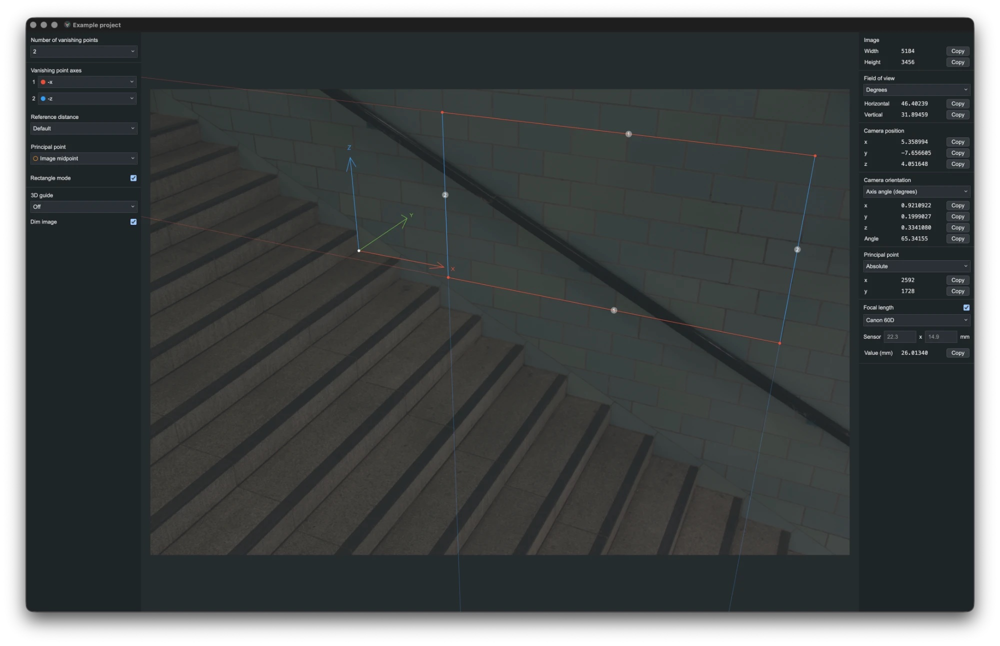
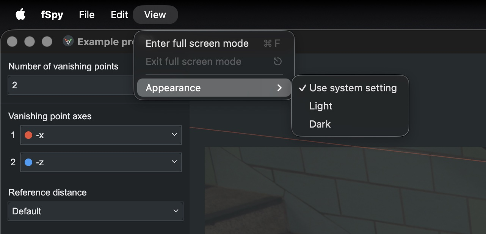

## About this build

This is a modified version of [fSpy](https://github.com/stuffmatic/fSpy) by Per Gantelius, maintained by Ryan Hussain. It is not an official fSpy release. It is distributed under the same GPL-3.0 license; see [CHANGES.md](CHANGES.md) for what was changed.

Changes from the original:

- Runs natively on Apple Silicon Macs (Electron upgraded from 8 to 44)
- Dark theme, selectable under **View → Appearance** (follows the system setting by default)
- Copy and paste work in text fields, and the result panel's Copy buttons work again



Switch between the system setting, light and dark themes under **View → Appearance**:



### Installing on macOS (Apple Silicon)

This build is not notarized by Apple, so macOS asks you to approve it once:

1. Open the `.dmg` and drag **fSpy** to Applications.
2. Open fSpy. macOS warns that it can't verify the app. Click **Done**.
3. Open **System Settings → Privacy & Security**, scroll down, and click **Open Anyway** next to fSpy. Confirm with your password.

Alternatively, run this in Terminal after copying the app to Applications:

```
xattr -dr com.apple.quarantine /Applications/fSpy.app
```

Each release lists SHA-256 checksums. To check your download, run `shasum -a 256` on the file and compare.

### Building on macOS (Apple Silicon)

Requires Node.js 22. From the repository root:

```
npx yarn@1.22.22 install --ignore-optional
npx yarn@1.22.22 run dist-mac-arm64
```

The app is written to `dist/mac-arm64/fSpy.app`, along with a `.dmg` and `.zip`. Apps you build yourself open without the approval step.

## What is this?

fSpy is an open source, cross platform app for still image camera matching. See [fspy.io](https://fspy.io) for more info. The source code is available under the GPL license.


## Backstory

Once upon a time I wrote BLAM, a [Blender](https://blender.org) add-on for still image camera calibration that, despite its clunky UI, has gained some popularity in the Blender community. fSpy is an attempt to bring BLAM's functionality to a wider audience in the form of a stand alone app.

## Using the computed camera parameters in other applications

In theory, camera parameters computed by fSpy could be used in any application that has a notion of a 3D camera and provides some way of setting the camera parameters. If you're a Blender user, have a look at the [offical fSpy importer add-on](https://github.com/stuffmatic/fSpy-Blender). If you're using an application without a dedicated importer, you may still be able to manually copy the camera parameters from fSpy.

Interested in writing an importer for your favorite application? Then the [fSpy project file format spec](https://github.com/stuffmatic/fSpy/blob/develop/project_file_format.md) is a good starting point.


## Building and running

The following instructions are for developers. If you just want to run the app, [download the latest executable for your platform](https://github.com/stuffmatic/fSpy/releases).

fSpy is written in [Typescript](https://www.typescriptlang.org) using [Electron](https://electronjs.org), [React](https://reactjs.org) and [Redux](https://redux.js.org). [Visual Studio Code](https://code.visualstudio.com) is recommended for a pleasant editing experience.

To install necessary dependencies, run

```
yarn
```

The `src` folder contains two subfolders `main` and `gui`, containing code for the [Electron main and renderer processes](https://electronjs.org/docs/tutorial/application-architecture) respectively.

Here's how to run the app in development mode

1. Run `yarn dev-server` in a separate terminal tab to start the dev server
2. Run `yarn build-dev` to build both the main and GUI code. This build step is needed to generate main process code used to start up the app.
3. Run `yarn electron-dev` in a separate terminal tab to start an Electron instance which uses the dev server to provide automatic reloading on GUI code changes.

⚠️ The current build process is not ideal. For example, it lacks support for live reloading on main process code changes. Changes to main process code require a manual rebuild, i.e steps 2-3, in order to show up in the app.


## Creating binaries for distribution

To create executables for distribution, run

```
yarn dist
```

which invokes [Electron builder](https://github.com/electron-userland/electron-builder).
